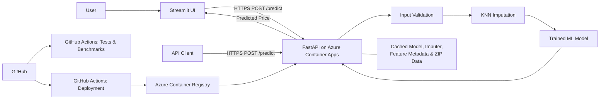

# Seattle Home Value Estimator

**An end-to-end machine learning application for estimating residential property values in the Seattle area.**

This project connects a trained home-price prediction model to a REST API and an interactive web interface. It focuses on making model inference practical for real-world property data: accepting incomplete inputs, reusing expensive resources, testing the API in containers, and deploying the service to the cloud.

## Highlights

- **Flexible predictions:** ZIP code is required; seven other property inputs may be omitted and are handled using KNN imputation.
- **FastAPI backend:** Validated JSON requests, `/predict` inference endpoint, `/health` health check, and interactive API documentation.
- **Interactive frontend:** Streamlit form for entering property details and displaying an estimated value.
- **Resource caching:** Reuses the trained model, imputer, feature metadata, and ZIP-code demographic data instead of reloading them on every request.
- **Reproducible testing:** Docker-based unit and integration tests, plus performance benchmarks, through simple Makefile commands.
- **Cloud deployment:** Azure Container Apps, Azure Container Registry, and GitHub Actions workflows.

## Architecture



The API uses an existing trained model and a fitted KNN imputer. The focus of this project is **model serving and ML engineering**, rather than model retraining.

## Technology

**Python · FastAPI · Streamlit · scikit-learn · Docker · Docker Compose · pytest · GitHub Actions · Azure Container Apps · Azure Container Registry**

## Repository Layout

```text
.
├── .github/workflows/       # CI, benchmarking, and deployment workflows
├── .streamlit/
│   └── secrets.toml.example # Example frontend configuration
├── src/
│   ├── api/endpoints.py     # Prediction API
│   ├── data/                # Supporting data
│   ├── main.py              # FastAPI application
│   ├── model/               # Model artifacts and feature metadata
│   ├── ui/app.py            # Streamlit frontend
│   └── utils/loader.py      # Resource loading and caching
├── test/
│   ├── integration/         # Tests against a running API
│   └── unit/                # In-process tests
├── Dockerfile
├── Dockerfile.test
├── docker-compose.test.yml
├── Makefile
├── benchmark.py
├── benchmark_loading.py
└── requirements.txt
```

Some paths describe the intended repository layout; consult the repository for the current set of tracked files.

## Quick Start

### Requirements

- Git
- Docker Desktop (or another working Docker engine)
- `make`

### 1. Clone the repository

```bash
git clone https://github.com/pegahmirghafari/real_estate_price_estimator.git
cd real_estate_price_estimator
```

### 2. Build and start the API

```bash
docker build -t realstateestimator-api .
docker run -d --name realstateestimator-api-local -p 8000:8000 realstateestimator-api
```

Verify the service:

```bash
curl http://localhost:8000/health
```

Interactive API documentation is available at `http://localhost:8000/docs`.

### 3. Request a prediction

```bash
curl -X POST http://localhost:8000/predict \
  -H "Content-Type: application/json" \
  -d '{
    "bedrooms": 3,
    "bathrooms": 2.0,
    "sqft_living": 1500,
    "sqft_lot": 5000,
    "floors": 1,
    "sqft_above": 1200,
    "sqft_basement": 300,
    "zipcode": "98042"
  }'
```

The response has the form:

```json
{"predicted_price": 239141.6}
```

The example value is from a verified run; results depend on the deployed model artifacts.

You can also omit property details and supply only the ZIP code:

```bash
curl -X POST http://localhost:8000/predict \
  -H "Content-Type: application/json" \
  -d '{"zipcode": "98042"}'
```

The missing property values are filled using the fitted KNN imputer before inference.

When finished:

```bash
docker rm -f realstateestimator-api-local
```

## Streamlit Frontend

The Streamlit interface lives in `src/ui/local_app.py` and calls the FastAPI prediction endpoint over HTTP.

1. In a Python environment with the frontend dependencies installed, run from the repository root:

   ```bash
   streamlit run src/ui/loacl_app.py
   ```

2. Open `http://localhost:8501`.

## Testing and Benchmarks

The repository provides a single reproducible command to run the validation workflow:

```bash
make test-all
```

This builds the test image, starts the API service, runs integration and unit tests, executes both benchmarks, and cleans up the temporary Docker Compose resources.

For individual workflows:

```bash
make test-unit
make test-integration
make benchmark
```

### Latest verified local results

| Check | Result |
| --- | --- |
| Integration tests | **5 / 5 passed** |
| Unit tests | **14 / 14 passed** |
| Unit-test coverage | **76% overall**; **94%** for `src/api/endpoints.py` |
| API request benchmark | **100 / 100 successful requests** |
| Mean API response time | **4.63 ms** |
| Median API response time | **3.99 ms** |
| 95th percentile API response time | **6.65 ms** |
| Maximum observed API response time | **44.57 ms** |
| Repeated disk-based resource loading | **16.174 ms mean** over 100 iterations |
| Cached resource access | **< 0.001 ms mean** over 100 iterations |

These numbers are from one local benchmark run, **not** a production latency guarantee or a concurrency/load-test result. They are useful for comparing resource-loading approaches in the tested environment. Integration-test coverage is not included in the unit-test coverage figure because the API runs in a separate process/container.

## Engineering Decisions

### Missing-value handling

The API requires `zipcode` and accepts nullable values for bedrooms, bathrooms, living area, lot size, floors, above-ground area, and basement area. Missing property features are imputed with a previously fitted KNN imputer before the model makes its prediction.

**Trade-off:** KNN imputation allows incomplete requests but adds preprocessing work and depends on the distribution represented by the fitted imputer. Imputed estimates should not be mistaken for observed property characteristics.

### Caching inference resources

The service uses cached loading for the trained model, imputer, feature metadata, and ZIP-code demographic data. This avoids repeated disk reads and deserialization for successive requests.

**Trade-off:** Caching improves repeated-request efficiency but increases persistent process memory usage. Model updates require a deliberate reload or application restart.

### Container-based validation

Unit tests validate application behavior, while integration tests exercise HTTP calls against a running API container. Docker Compose coordinates the integration environment and performs cleanup after the workflow.

**Trade-off:** Container-based integration tests are slower than in-process tests, but provide stronger confidence in networking and runtime configuration.

## CI/CD and Cloud Deployment

GitHub Actions workflows are configured for automated validation, scheduled or manually triggered benchmarks, and Azure deployment. The deployment design uses GitHub Actions OIDC authentication, Azure Container Registry for application images, and Azure Container Apps to serve the API.

The public API hostname can be configured independently of the frontend through Streamlit secrets. A live deployment may be stopped or unavailable; the Docker instructions above provide a local path to reproduce the application.

## Deploy to Microsoft Azure (Step by Step)

These instructions deploy the **FastAPI backend** to **Azure Container Apps**. Streamlit is a separate frontend and can be hosted independently. Azure resources may incur charges even when the application is idle; review pricing and clean up resources you no longer need.

### Prerequisites

- An Azure subscription with permission to create resource groups, registries, and Container Apps resources.
- The [Azure CLI](https://learn.microsoft.com/en-us/cli/azure/install-azure-cli) installed locally.
- Docker installed if you want to build or test the container locally.
- A checkout of this repository containing the production `Dockerfile` and required model artifacts.

> **Naming:** The GitHub repository and local project are named **RealStateEstimator**. Azure resource names must follow Azure-specific naming rules; examples below use lowercase names. Container Registry names must be globally unique and contain only alphanumeric characters. The existing deployment may still use legacy Azure resource names; do not rename them in workflow files unless you also migrate the Azure resources.

### 1. Sign in and choose a subscription

```bash
az login
az account list --output table
az account set --subscription <"YOUR_SUBSCRIPTION_ID">
```

Check the selected subscription:

```bash
az account show --query '{name:name,id:id}' --output table
```

### 2. Install the Container Apps CLI extension and register providers

```bash
az extension add --name containerapp --upgrade
az provider register --namespace Microsoft.App
az provider register --namespace Microsoft.OperationalInsights
az provider register --namespace Microsoft.ContainerRegistry
```

Provider registration can take a few minutes. You can inspect its state with:
- `az provider show --namespace Microsoft.App --query registrationState -o tsv`.
- `az provider show --namespace Microsoft.OperationalInsights --query registrationState -o tsv`.
- `az provider show --namespace Microsoft.OperationalInsights --query registrationState -o tsv`.

### 3. Define deployment variables

Run these commands in the same terminal session. Replace the registry name with a **globally unique** value.

```bash
RESOURCE_GROUP="realstateestimator-rg"
LOCATION="eastus"
ENVIRONMENT="realstateestimator-env"
APP_NAME="realstateestimator-api"
ACR_NAME="realstateestimator<YOURUNIQUEID>" #Registry name must use only lowercase
IMAGE_NAME="realstateestimator-api"
IMAGE_TAG="v1"
```

### 4. Create the resource group and Azure Container Registry

```bash
az group create --name "$RESOURCE_GROUP" --location "$LOCATION"

az acr create --resource-group "$RESOURCE_GROUP" --name "$ACR_NAME" --sku Basic
```

### 5. Build the Docker image in Azure Container Registry

From the repository root:

```bash
az acr build --registry "$ACR_NAME" --image "$IMAGE_NAME:$IMAGE_TAG" .
```
This remote build avoids local CPU-architecture differences. The image must include the model, imputer, feature metadata, and data files required by the API.

### 6. Create a Container Apps environment

```bash
az containerapp env create --name "$ENVIRONMENT" --resource-group "$RESOURCE_GROUP" --location "$LOCATION"
```

### 7. Deploy the API with a managed identity for image pulls

First, retrieve the registry login server:

```bash
ACR_SERVER=$(az acr show --name "$ACR_NAME" --resource-group "$RESOURCE_GROUP" --query loginServer -o tsv)
```

For an initial deployment, create the app with a public ingress endpoint and a **system-assigned managed identity**:

```bash
az containerapp create --name "$APP_NAME" --resource-group "$RESOURCE_GROUP" --environment "$ENVIRONMENT" --image "mcr.microsoft.com/azuredocs/containerapps-helloworld:latest" --target-port 8000 --ingress external --system-assigned
```

Next, give that identity permission to pull images from ACR:

```bash
PRINCIPAL_ID=$(az containerapp show --name "$APP_NAME" --resource-group "$RESOURCE_GROUP" --query identity.principalId -o tsv)

ACR_ID=$(az acr show --name "$ACR_NAME" --resource-group "$RESOURCE_GROUP" --query id -o tsv)

az role assignment create --assignee-object-id "$PRINCIPAL_ID" --assignee-principal-type ServicePrincipal --scope "$ACR_ID" --role AcrPull
```

Configure the registry to use the app's managed identity, then deploy the actual API image:

```bash
az containerapp registry set --name "$APP_NAME" --resource-group "$RESOURCE_GROUP"  --server "$ACR_SERVER" --identity system

az containerapp update --name "$APP_NAME" --resource-group "$RESOURCE_GROUP" --image "$ACR_SERVER/$IMAGE_NAME:$IMAGE_TAG"
```

> **Important:** Azure role assignments can take several minutes to propagate. If the image pull fails immediately after assigning `AcrPull`, wait briefly and retry the update. Registries using **ABAC repository permissions** may require a repository-scoped reader role rather than the classic `AcrPull` role. Also verify the registry allows ARM-audience authentication for managed-identity pulls if your configuration requires it. Avoid storing ACR administrator passwords in the repository.

### 8. Get the deployed URL and test it

```bash
FQDN=$(az containerapp show --name "$APP_NAME" --resource-group "$RESOURCE_GROUP" --query properties.configuration.ingress.fqdn -o tsv)

API_URL="https://$FQDN"
echo "$API_URL"
curl "$API_URL/health"
```

Send a sample prediction:

```bash
curl -X POST "$API_URL/predict" -H "Content-Type: application/json" -d '{"zipcode":"98042","bedrooms":3,"bathrooms":2.0,"sqft_living":1500,"sqft_lot":5000,"floors":1,"sqft_above":1200,"sqft_basement":300}'
```

Open `https://<your-app-fqdn>/docs` to explore the FastAPI documentation. If a request fails, inspect application logs:

```bash
az containerapp logs show \
  --name "$APP_NAME" \
  --resource-group "$RESOURCE_GROUP" \
  --follow
```

### 9. Connect Streamlit to the Prediction API

The Streamlit interface lives in `src/ui/app.py`  It provides an interactive interface for entering property information and receiving home-value predictions from the FastAPI service deployed on Azure Container Apps.

The frontend communicates with the deployed API over HTTPS. The API endpoint is configured using Streamlit secrets rather than being hardcoded in the application.

The frontend supports two configurations:

* Local development: Connect to FastAPI running at http://localhost:8000 (`src/ui/local_app.py`).
* Azure deployment: Connect to the publicly accessible FastAPI endpoint hosted on Azure Container Apps(`src/ui/app.py`).

1. Create a local secrets file from the example
From the repository root, create the Streamlit configuration directory and copy the example configuration file:

   ```bash
   mkdir -p .streamlit
   cp .streamlit/secrets.toml.example .streamlit/secrets.toml
   ```

2. Edit `.streamlit/secrets.toml` to point to your running API:

```toml
API_URL = "https://YOUR_CONTAINER_APP_FQDN"
```

Replace YOUR_CONTAINER_APP_FQDN with the hostname assigned to your deployed Azure Container App.

3. In a Python environment with the frontend dependencies installed, run from the repository root:

   ```bash
   streamlit run src/ui/app.py
   ```
The application sends prediction requests to the deployed FastAPI service using:
 
 ```bash
   response = requests.post(
    f"{API_URL}/predict",
    json=payload,
    timeout=10,
)
   ```
This separates deployment-specific configuration from the application code.

4. Open the application in your browser: `http://localhost:8501`.

The app reads its endpoint from `st.secrets["API_URL"]`. **Do not commit `.streamlit/secrets.toml`**; only commit the `.example` template. For a hosted Streamlit app, configure `API_URL` through the hosting platform's secrets settings.

> **Configuration note:** If `.streamlit/secrets.toml.example` has not yet been added to your checkout, create it with `API_URL = "http://localhost:8000"` and commit that example file. The URL is configuration, not an authentication credential.

In your **local**, Git-ignored `.streamlit/secrets.toml`:

```toml
API_URL = "https://YOUR_CONTAINER_APP_FQDN"
```
The API URL is not itself a sensitive credential, but separating configuration from source code makes the application easier to maintain and deploy.

### 10. Automate deployment with GitHub Actions (optional)

The repository includes workflows under `.github/workflows/` for CI and Azure deployment. Before enabling CD for a new Azure subscription or renamed repository:

1. Create or identify a Microsoft Entra application/service principal with the minimum permissions required to push to ACR and update the Container App.
2. Configure a **federated identity credential** for the new GitHub repository and intended branch/environment. This enables GitHub Actions to authenticate via OIDC without storing an Azure client secret.
3. Configure the GitHub Actions Azure identifiers (`AZURE_CLIENT_ID`, `AZURE_TENANT_ID`, and `AZURE_SUBSCRIPTION_ID`) using the variable/secret names expected by **your actual** `deploy.yml`.
4. Update the workflow's resource group, registry, image name, Container App name, and branch triggers to match this deployment. Review `.github/workflows/deploy.yml` before changing anything: the precise workflow inputs and permissions are repository-specific.
5. Push a change, verify that CI passes, and inspect the deployment workflow logs. Confirm the newly deployed `/health` and `/predict` endpoints.

Useful references: [GitHub OIDC with Azure](https://learn.microsoft.com/en-us/azure/developer/github/connect-from-azure-openid-connect), [Azure Login GitHub Action](https://github.com/Azure/login), and [Azure Container Apps documentation](https://learn.microsoft.com/en-us/azure/container-apps/overview).

### 11. Clean up Azure resources

**Warning:** This permanently deletes everything in the resource group, including the registry and deployed app. Only run it if the resource group contains resources you intend to remove.

```bash
az group delete --name "$RESOURCE_GROUP" --yes --no-wait
```

## Limitations and Next Steps

This project is a demonstration of an ML serving workflow, **not** a production real-estate appraisal system. Possible improvements include:

- Model quality evaluation on held-out and more recent housing data
- Data drift monitoring and model versioning
- Authentication, rate limiting, and tighter API access controls
- Observability dashboards, alerting, and structured production metrics
- Concurrency and sustained-load testing
- Expanded input validation and frontend usability tests

## Project Background

This repository builds on a provided home-price prediction model and imputation research, extending the system with robust API handling, performance optimizations, automated validation, cloud deployment, and an interactive frontend. It is presented here as an **ML engineering portfolio project** to demonstrate end-to-end deployment and software engineering practices.
